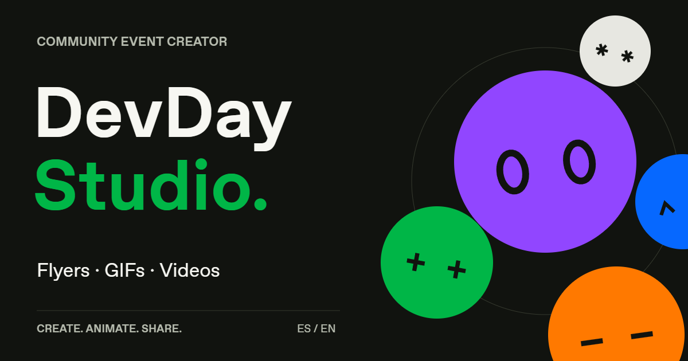

# DevDay Studio

[English](README.md) · [Español](README.es.md) · [Abrir la aplicación](https://devday-community-studio-ec.israelgo93.chatgpt.site/)

Editor de piezas promocionales para comunidades DevDay: completa un formulario, mira el resultado en tiempo real y descarga imágenes o animaciones para tus eventos.

Proyecto de la comunidad mantenido en **globodex**; no es un producto oficial de OpenAI.

## Funcionalidades

- Crear, editar y eliminar eventos, con ejemplos precargados de Ecuador.
- Plantillas Community, Speaker y Editorial; fondo claro u oscuro, colores y fotografía.
- Cuadrado 1080 × 1080, retrato 1080 × 1350, historia 1080 × 1920 y horizontal 1920 × 1080.
- Agentes animados con órbita, rebote, ondas, flotación o expresiones; también composición estática.
- Descargas PNG, JPG, GIF y video MP4/WebM según el navegador.
- Copias JSON del diseño y de la lista de eventos.
- Interfaz y contenido automático de la pieza en español o inglés, de forma independiente.
- Entrada y salida con ChatGPT en el despliegue alojado en Sites.

## Instalar y desarrollar

Necesitas **Node.js 22 o superior**, npm y un navegador actual. Para el desarrollo local no hacen falta API keys, una base de datos ni una cuenta de ChatGPT.

~~~sh
git clone https://github.com/globodex/devday-studio.git
cd devday-studio
npm ci
npm run dev
~~~

Abre la URL que indique Vite, normalmente http://127.0.0.1:5173.

Para verificar la aplicación y simular la entrada/salida local:

~~~sh
npm test
npm run build
npm run preview:auth -- --mock-auth
~~~

La simulación está en http://127.0.0.1:4173 y utiliza una identidad ficticia. No completa OAuth con ChatGPT ni forma parte del despliegue publicado.

| Comando | Función |
| --- | --- |
| `npm run dev` | Editor con recarga inmediata, sin autenticación. |
| `npm test` | 22 pruebas de dominio, persistencia, acceso y metadatos sociales. |
| `npm run build` | TypeScript, Vite y empaquetado del Worker de Sites. |
| `npm run preview` | Vista estática del build, sin la autenticación de Sites. |
| `npm run preview:auth` | Bienvenida pública y puerta de acceso del Worker compilado. |
| `npm run preview:auth -- --mock-auth` | Entrada y salida simuladas, solo en loopback. |

## Cómo usarlo

1. Selecciona o crea un evento en **Tus eventos**.
2. Elige plantilla, tema y orientación.
3. Completa título, ciudad, fecha, lugar y datos del speaker. Puedes añadir una foto.
4. Ajusta la animación y su duración. Pausa para elegir el fotograma de una imagen.
5. Descarga la pieza. Guarda un respaldo JSON si quieres seguir en otro navegador.

En el sitio publicado se entra con una cuenta de ChatGPT. **Cuenta → Cerrar sesión** cierra la sesión del Site, no la de todos los servicios de ChatGPT.

## Exportaciones y privacidad

Las imágenes PNG/JPG usan la resolución completa. El GIF tiene un máximo de 720 px en su lado mayor y 12 fotogramas por segundo, con bucle infinito. El video intenta usar 30 fps y 8 Mbps; MP4 depende del navegador y puede sustituirse por WebM. No lleva audio. Mantén la pestaña visible durante la grabación.

Los diseños, eventos y fotos se guardan en **localStorage de este navegador**, con claves por cuenta en el sitio alojado. No existe sincronización en la nube ni base compartida de eventos. Este almacenamiento no está cifrado y las copias JSON pueden incluir fotos y datos de tus eventos.

Los eventos precargados son ejemplos editables, no una sincronización con Luma. Conservan horarios de Ecuador (UTC−5). Manta tiene una discrepancia de fecha en la fuente que debe confirmar el organizador.

## Publicar tu propia versión

El proyecto usa React 19, TypeScript strict, Vite 6, Canvas 2D, gifenc y MediaRecorder. El build genera un Worker en `dist/server/index.js`.

**Clonar el código no configura automáticamente el acceso con ChatGPT.** Esa autenticación la gestiona Sites. Para tu versión, registra un Site propio y cambia el identificador y las URL públicas. El identificador del demo en `.openai/hosting.json` no es una credencial ni concede permisos.

Si lo alojas fuera de Sites, debes implementar autenticación verificada antes de exponer el Worker. Consulta la [guía de despliegue](docs/DEPLOYMENT.md).

## Documentación y contribuciones

- [Guía de uso detallada](docs/USAGE.es.md)
- [Arquitectura y mapa del código](docs/ARCHITECTURE.md)
- [Despliegue y metadatos sociales](docs/DEPLOYMENT.md)
- [Cómo contribuir](CONTRIBUTING.md)
- [Reportar vulnerabilidades](SECURITY.md)
- [Procedencia de recursos](ASSETS.md) y [avisos de terceros](THIRD_PARTY_NOTICES.md)

Puedes [reportar un problema o proponer una mejora](https://github.com/globodex/devday-studio/issues/new/choose), hacer un fork y enviar un pull request a `main`. Se aceptan contribuciones en español e inglés.

Antes de enviar cambios, ejecuta `npm test` y `npm run build`. Mantén los tipos estrictos, las traducciones ES/EN y la misma función de renderizado para vista previa y exportaciones.

## Licencia

El código y la documentación originales usan [MIT](LICENSE). Las fuentes, imágenes de marca y fotografías de terceros no se relicencian bajo MIT; consulta [THIRD_PARTY_NOTICES.md](THIRD_PARTY_NOTICES.md). Los nombres y marcas de OpenAI y ChatGPT conservan sus respectivos titulares.
